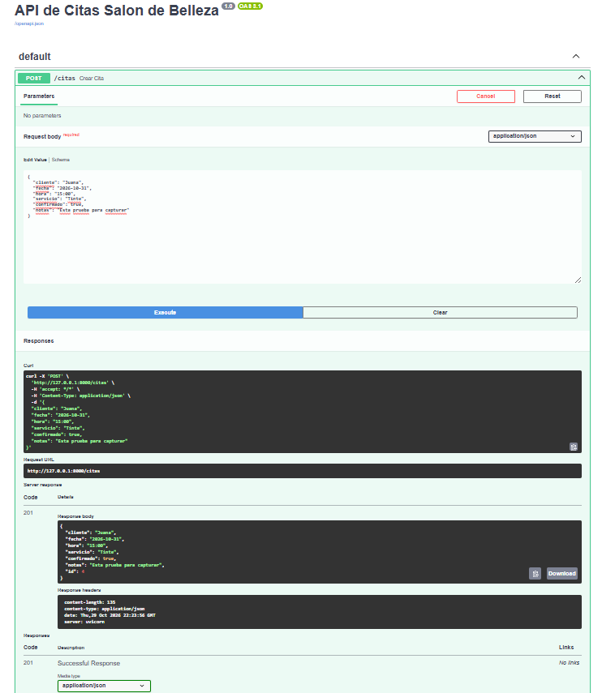
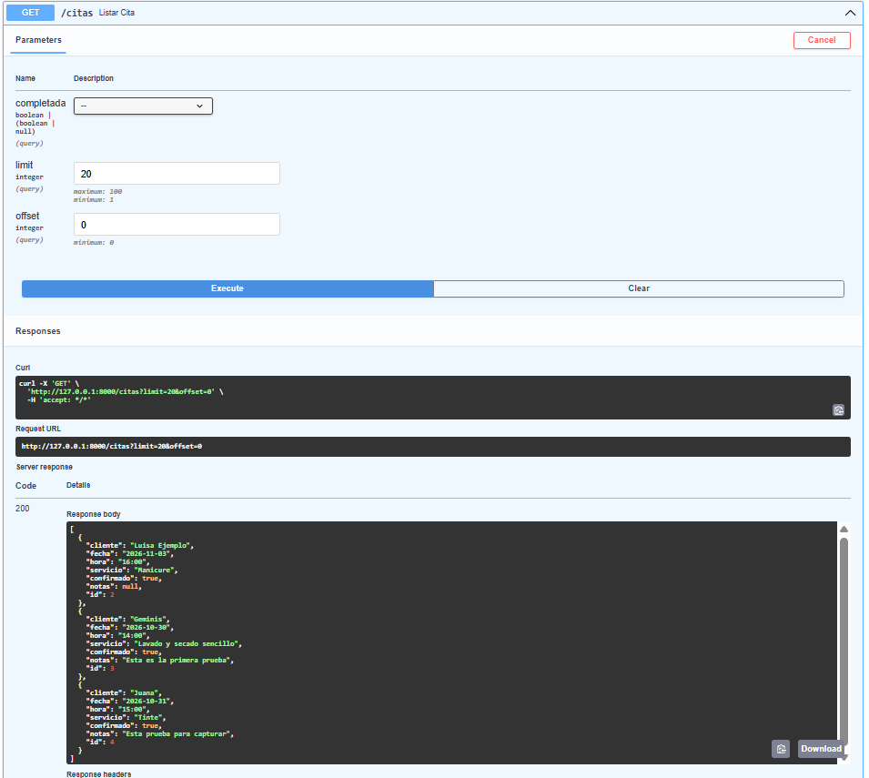
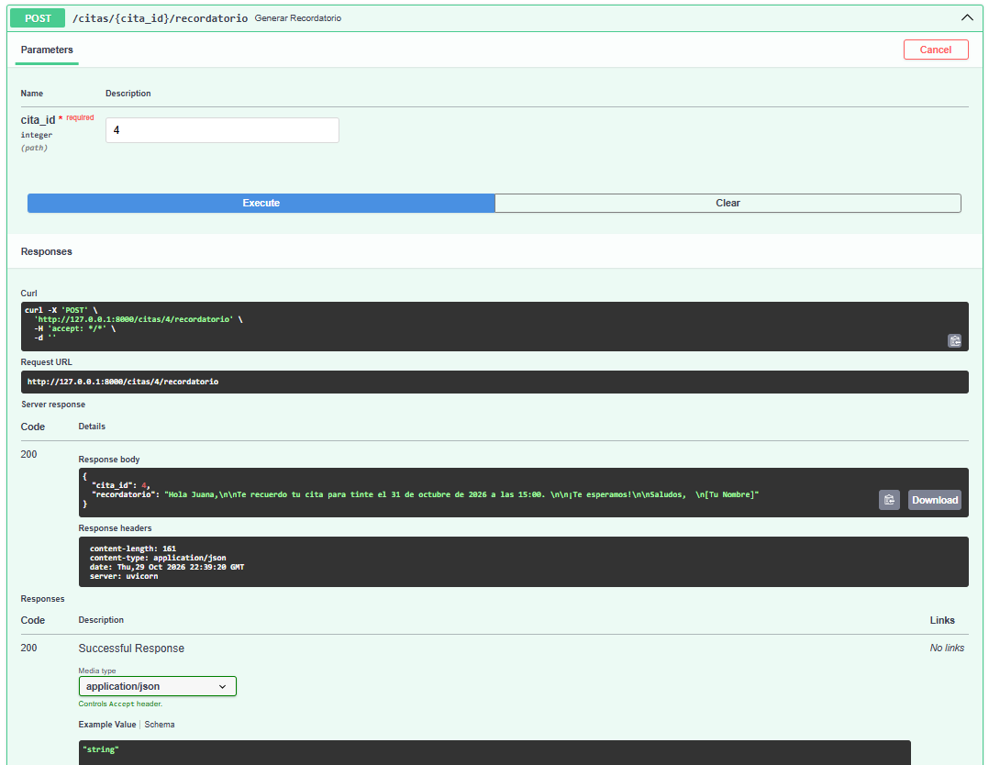
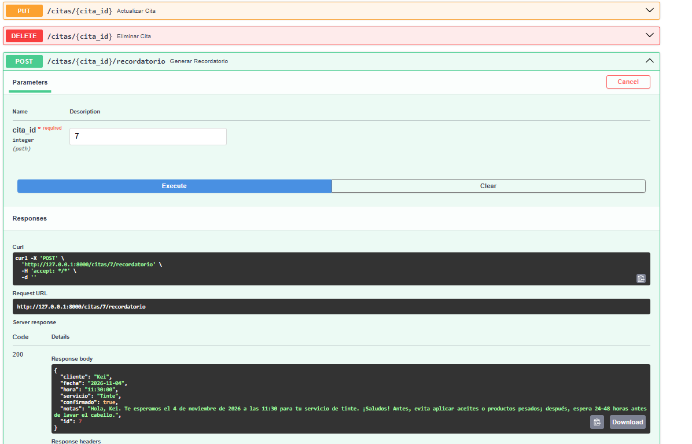

# API de citas para salón de belleza

API desarrollada con FastAPI para gestionar ficticiamente citas de un salón de belleza y generar recordatorios mediante inteligencia artificial.

## Instalación

```bash
uv sync
cp .env.example .env
```

En Windows, PowerShell:

```powershell
Copy-Item .env.example .env
```

Configura `AI_API_KEY` en `.env` con tu clave personal de OpenAI. Nunca subas `.env` a GitHub.

## Ejecución

```bash
uv run uvicorn main:app --reload
```

Documentación interactiva:

- Swagger: http://127.0.0.1:8000/docs
- ReDoc: http://127.0.0.1:8000/redoc

## Endpoints

| Método | Ruta | Descripción |
|---|---|---|
| POST | `/citas` | Crear una cita |
| GET | `/citas` | Listar citas; admite `confirmado`, `limit` y `offset` |
| GET | `/citas/{cita_id}` | Consultar una cita |
| PUT | `/citas/{cita_id}` | Actualizar una cita |
| DELETE | `/citas/{cita_id}` | Eliminar una cita |
| POST | `/citas/{cita_id}/recordatorio` | Generar y guardar un recordatorio con IA |

## Persistencia

Las citas se almacenan en `citas.db` mediante SQLite. Los datos se conservan al reiniciar el servidor.

## Capturas de `/docs`




